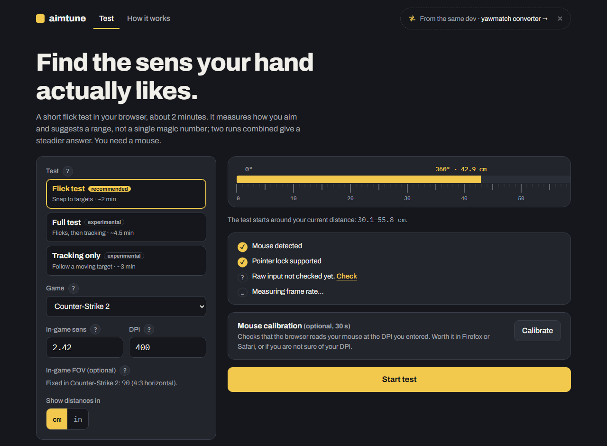
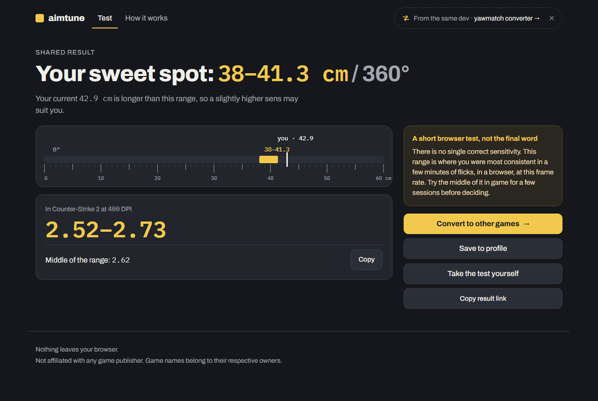

# aimtune

Find a mouse sensitivity range that fits your hand, with a short flick test in your browser.

[](https://github.com/umut-hope/Aim-Tune/actions/workflows/deploy.yml)

## Try it

**[umut-hope.github.io/Aim-Tune](https://umut-hope.github.io/Aim-Tune/)**

No install, no account. Open it on a computer with a mouse; the test takes about 2–3 minutes.





## What it does

You pick your game, sens and DPI, and one of two tests:

- **Flick:** in a simple 3D room you flick from a white dot to yellow targets and click once per target.
- **Tracking:** you keep the crosshair on a target that moves along a smooth, changing path.

Each round tests two distances per 360°, keeps the part of the range that scored better, and narrows it down.
At the end you get:

- the range where you were most consistent, in cm/360 (or in/360) and in your game's sens
- your current setting on the same ruler, so you can see how far off it is
- how much you overshot or undershot in each round
- an optional **A/B feel test**: aim freely and switch between two settings (for example your current one and
  the recommended one) with Space, blind if you like, then pick the one that feels better
- a link to convert the result to other games in [yawmatch](https://umut-hope.github.io/Yaw-Match/), and a
  result link you can share

There is no single correct sensitivity. aimtune reports a range, explains how it was measured
(see *How it works* on the site), and is open about its limits: browser input, frame rate and a few minutes of
flicks are not a real match. Treat the result as a starting point.

## How the test works

- Everything is measured as **distance per 360° turn** (cm/360), so results do not depend on the game.
  Conversion to in-game sens uses the same math as yawmatch:
  `cm/360 = 360 / (sens × yaw) / DPI × 2.54`.
- The camera uses your game's **field of view**, so targets appear where they would in game.
- Every miss is split into an error **along the flick** (positive = overshoot, negative = undershoot)
  and **to the side**, relative to the flick size. Shots are scored mainly on accuracy, with time as a smaller
  factor.
- When two distances score about the same, systematic overshoot (sens too high) or undershoot (sens too low)
  decides the round.
- The final range is never narrower than ±4% and widens when your flicks were inconsistent.
- Tracking splits the miss into **ahead of** and **behind** the moving target. Reaction time makes everyone
  trail a little and tracking scores change slowly with sens, so tracking rounds are decided by score alone
  and undecided rounds keep the range: tracking results are honestly wider than flick results.
- Both procedures are checked against simulated players (flickers and trackers) before they are trusted.

## Links

- Prefill the setup: `?game=cs2&sens=1.2&dpi=800`
- Shared results carry the numbers in the address: `?lo=38&hi=41.3&cur=42.9&game=cs2&dpi=400`
- Game data (yaw, FOV) is loaded at runtime from yawmatch's
  [`games.json`](https://umut-hope.github.io/Yaw-Match/data/games.json); nothing is copied into this repo.

## Privacy

Everything runs in your browser. There is no backend, no account and no analytics. The only things stored are
your unit choice and, if you press *Save to profile*, your game, sens and DPI in your browser's local storage
(`shared:profile`, shared with yawmatch).

## Development

Requires Node.js 24.

```bash
npm install
npm run dev       # http://localhost:5173/Aim-Tune/
npm test          # unit tests, including simulated players
npm run check     # type checking
npm run build     # production build in dist/
```

Project layout:

```
src/
  core/     pure logic: angle errors, scoring, range search, FOV (tested, no DOM)
  scene/    three.js room, targets and pointer lock input
  tests/    flick test and A/B test: flows (state machines) and their screens
  ui/       setup, results and other Svelte screens
  data/     game list loader with Zod validation
```

Unit conversion and FOV math come from [yawmatch](https://github.com/umut-hope/Yaw-Match)'s `src/core`,
installed as a git dependency, so both sites always agree on the numbers. three.js is only loaded when a test
starts.

Pushes to `main` are tested and deployed to GitHub Pages by
[a GitHub Actions workflow](.github/workflows/deploy.yml).

## License

[MIT](LICENSE)

Not affiliated with any game publisher. Game names belong to their respective owners.
